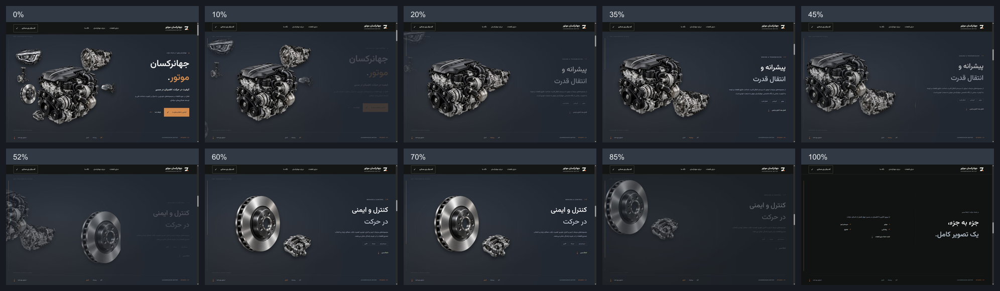

# Phase 3 — one continuous automotive exhibition

## Files changed

| File | Change |
| --- | --- |
| `src/components/Hero.astro` | One shared stage: background, grouped independent pictures, four semantic content panels, atmosphere, progress and chapter links. Includes natural-flow fallback content. |
| `src/styles/cinematic-hero.css` | Replaces Phase 2 hero styling with scoped studio colors, normalized compositions, a fixed typography region, sticky enhancement and responsive fallback. |
| `src/scripts/cinematic-hero.ts` | Replaces the two-part bridge with one labeled master timeline for hero, engine, brakes and the final handoff. |
| `src/scripts/landing.ts` | Initializes the new experience and removes the conflicting autoplay hero entrance. Existing header/menu and later chapter behavior remain. |
| `src/components/Narrative.astro` | Engine and braking now belong to the shared stage. Lighting and suspension retain their existing markup and normal page flow. The existing introduction/chapter navigation now forms the handoff. |
| `src/data/landing.ts` | Updates only the two scoped chapter descriptions with the requested draft copy. All seven asset entries remain. |
| `README.md` | Points to this implementation and validation report. |

Header, brand, company/capability, contact and footer components were not edited. No automotive assets, fonts, dependencies or framework configuration were changed.

## Architecture

The desktop enhancement activates at widths of at least 1024px, heights of at least 600px and `prefers-reduced-motion: no-preference`. The height guard keeps very short desktop windows readable through the static fallback.

One 600svh experience contains a native CSS sticky 100svh stage, giving 500svh of native scroll travel. One ScrollTrigger (`automotive-experience`) drives one deterministic GSAP timeline with `start: top top`, `end: bottom bottom`, scrub 0.65 and refresh invalidation. There is no GSAP pin spacer, double pin, wheel interception, forced snapping or replacement of native scrolling. After the 500svh interval, the sticky stage leaves in normal document flow.

The stage separates:

1. A charcoal/graphite background and restrained radial lighting.
2. A clipped left visual region, occupying 60% of the stage.
3. A right content region, reserving 40% including safe padding.
4. A noninteractive atmospheric layer, footer navigation and progress rail.

The image canvas has a stable 1.12 aspect ratio. CSS percentages define each image's box; percentage translations define poses. Engine and gearbox share one parent transform group; disc and caliper share another. Individual children own composition adjustments, and the parent groups own coordinated departures/entrances. All products retain square intrinsic dimensions, transparent artwork, uniform scaling and `object-fit: contain`.

The engine is the hero reference size. Gearbox width is approximately 48% of engine width, hero disc 36%, headlight 40%, and mirror/suspension smaller. Silhouettes have deliberate gaps, with the gearbox slightly behind/above the engine. The visual region clips departing/entering products before they can cover text or CTAs.

## Master timeline

| Normalized progress | Behavior |
| --- | --- |
| 0–12% | Hero copy moves upward/fades. The powertrain drifts upward; supporting objects spread outward. The small hero brake pair departs. |
| 12–28% | The exact same engine/gearbox pictures settle into the first chapter pose. Corporate draft text enters from the right. |
| 28–43% | Stable Engine & Gearbox reading hold. Neither its parent nor child transforms change. |
| 43–60% | One parent moves engine/gearbox left/up. The brake group enters from right/lower while powertrain is still visible. Child brake poses reset only while the group is hidden. Text switches without readable overlap. |
| 60–78% | Stable Brake System reading hold, with disc primary and caliper alongside its outer region. |
| 78–92% | Brake group departs left/up; its text fades upward. The lighting shifts toward the existing normal-page background. |
| 92–100% | Existing introduction/chapter navigation completes its entrance (starts at 88%, fully visible by 96%) and remains on stage as it releases. No empty pinned ending. |

Timeline labels are exported as `storyLabels`, used as tween positions. The progress rail fixes the total duration at exactly 1. All relevant transform components have explicit from/to states, including both pixel and percentage translations. This prevents stale offsets after refresh or repeated desktop/mobile transitions. No independent infinite animation competes with the master.

## Continuity, navigation and lifecycle

The engine and gearbox in the animated hero and Scene 01 are the **same DOM elements**. The same disc/caliper are also reused from their small hero poses to the braking scene. Nothing is flattened or swapped into a background. Separate static picture pairs serve the mobile/no-JS/reduced-motion layout and remain hidden in the enhanced desktop stage.

Native fragment markers for `#powertrain` and `#braking` are moved outside the sticky container during enhancement. Their stable document positions target the centers of the two reading holds; teardown returns them to their original natural-flow positions. `#parts` starts the exhibition; `#more-parts` returns to the preserved later categories.

Only the rendered text panel is focusable and exposed to assistive technology. Access state follows the **master's rendered playhead**, so scrub lag during fast scrolling cannot activate a still-hidden next panel. MatchMedia cleanup reverts the GSAP context, removes image load listeners, restores anchors and clears inert/ARIA state. Authored inline styles are also restored exactly after reversion, preventing a shared `fromTo` start state from hiding fallback text.

Reserved image dimensions prevent image layout shift. Asset loads and the existing font-ready handler refresh ScrollTrigger. The existing Astro lifecycle disposes of the media contexts and navigation listeners before initializing again.

## Mobile, reduced motion and no JavaScript

Without the enhancement class, all three semantic articles and the handoff are ordinary readable content. Their order is heading/description → relevant image pair → CTA. The narrow hero shows only engine and gearbox, rather than squeezing seven parts into the screen. Every chapter remains present and accessible. Reduced-motion preference skips the master entirely; there is no hidden-by-default fallback content.

## Validation

- `npm run typecheck`: passed.
- `npm run build`: passed, one static page.
- Seven original PNG SHA-256 hashes still match the Phase 2 manifest. The existing 21 lossless WebP variants are preserved.
- All 32 referenced output asset paths exist. All seven stage images loaded in browser inspection. The production document contains 20 unique IDs and no duplicates.
- Visually inspected at 1440×900, 1280×720, 1024×768, 390×844 and 320×740. No horizontal/heading overflow; images remain inside their reserved region.
- Native chapter links, mobile menu expansion/Escape closing and the mobile primary CTA were exercised.
- Slow scroll checkpoints, large fast jumps and reverse scrolling were exercised. At 52%, every group matrix/opacity, all seven child image matrices/opacities and all four panel/access states matched exactly between forward and reverse renders.
- Repeated 1440 → 1280 → mobile → 1440 transitions tested refresh and teardown. The brake reading pose returns to the identity group matrix with opacity 1, and all four fallback panels return to visibility/opacity 1 with no inline style or inert residue.
- Stable engine/brake reading holds and the overlapping exchange were inspected. At 100% the handoff is fully visible. An additional 270px scroll moved the stage top to −270px and the next section top to 630px at the 900px viewport, confirming normal-flow release.
- No browser console errors observed.

The available browser API does not expose reduced-motion preference emulation. The query gate was reviewed, and its same static layout/teardown branch was inspected through mobile changes. A recording API was not available; the captures below are a checkpoint storyboard, not a recording or FPS benchmark. Hardware performance profiling and a cross-browser matrix were not performed.

## Visual evidence

Full-size requested frames: [0%](screenshots/phase-3/000.png), [10%](screenshots/phase-3/010.png), [20%](screenshots/phase-3/020.png), [35%](screenshots/phase-3/035.png), [45%](screenshots/phase-3/045.png), [52%](screenshots/phase-3/052.png), [60%](screenshots/phase-3/060.png), [70%](screenshots/phase-3/070.png), [85%](screenshots/phase-3/085.png), [100%](screenshots/phase-3/100.png).

Additional captures: [92% handoff](screenshots/phase-3/092.png), [1280 desktop](screenshots/phase-3/desktop-1280.png), [1024 desktop](screenshots/phase-3/desktop-1024.png), [1024 brakes](screenshots/phase-3/brakes-1024.png), [390 mobile](screenshots/phase-3/mobile-390.png), [320 mobile](screenshots/phase-3/mobile-320.png).

Machine-readable observations: [checkpoints](screenshots/phase-3/evidence.json), [exact reverse comparison](screenshots/phase-3/reverse-validation.json), [fallback cleanup](screenshots/phase-3/cleanup-validation.json).

Remaining content outside this phase: official contact channels and final approval of corporate copy/brand identity. The requested copy remains editable draft text; no company history or capabilities were independently verified.
