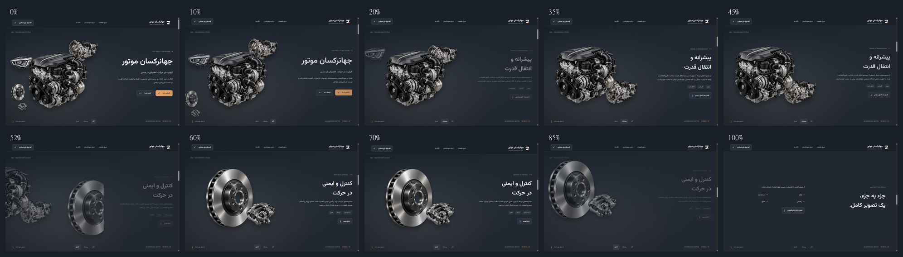

# Phase 4 — Premium visual refinement and cinematic motion

Implemented in the existing Astro/TypeScript site. The shared sticky stage, one reversible GSAP master, seven original automotive PNGs, existing sections and native navigation remain in place. No dependencies were added. Phase 3 captures remain available for comparison.

## 1. Typography

`src/styles/tokens.css` centralizes Vazirmatn, the type scale, line heights, colors and button dimensions. The existing locally hosted variable font is retained. Global styles explicitly cover headings, body text, links, navigation, controls and footer; former Arial shorthands were removed. Persian headings use zero letter spacing, readable line height and warm off-white. Decorative Latin captions retain their tracking.

The hero title is one semantic heading containing **جهانرکسان موتور**, without a forced line break or colored word. Its desktop column occupies 40% of the stage, with a 57% visual region and safe gutters. `clamp(44px, 4.35vw, 66px)` and desktop `nowrap` keep the name prominent and on one line. Tablet/mobile use their own scale and natural wrapping.

Rendered checks found Vazirmatn loaded, with no font-family exceptions among headings, paragraphs, links, buttons, form controls and footer elements.

## 2. Colors and buttons

Shared tokens follow the requested graphite palette: `#222831` main background, `#191F27` deep background, `#303944` surface, `#F4F5F6` headings, `#C0C8D1` secondary text, `#98A5B3` muted text, `#D79A61` copper and `#E5A36B` CTA. Large orange headings were replaced with off-white. Brand mark accent, favicon and browser theme color now agree with these tokens.

Primary **آشنایی با ما** uses a restrained copper gradient, dark label and arrow. Secondary **ارتباط با ما** uses outlined graphite. The same 11px radius and consistent typography extend to chapter links, header and contact actions. Desktop hero buttons measure approximately 50px high; mobile buttons are 48px. Transitions take 220ms, with small hover elevation and a 3px RTL arrow shift. Reduced-motion styles suppress these transforms. Keyboard focus remains a distinct 2px outline with 5px offset.

Existing destinations remain unchanged: primary `#powertrain`, secondary `#contact`, chapter actions `#braking` and `#more-parts`. Mobile navigation was exercised, including contact selection and closing.

Computed token contrast ratios (normal text AA threshold 4.5):

| Foreground / background | Ratio |
| --- | ---: |
| Primary / main graphite | 13.59 |
| Secondary / main graphite | 8.77 |
| Muted / main graphite | 5.91 |
| Muted / elevated graphite | 4.66 |
| Dark label / CTA | 7.72 |
| Dark label / copper gradient endpoint | 6.86 |

These are token-pair checks, not a claim of a complete WCAG audit. [Measured results](screenshots/phase-4/contrast.json).

## 3. White-line sources and cleanup

Inspection identified decorative hero axis/orbit markup, composition-reference strokes, a progress rail and its border styling, stage-footer decoration, later scene orbits/ghost labels, a narrative center stripe and an oversized contact pseudo-arrow. The hero axis/orbit/progress markup and their animation hooks were removed; later decorative styles were disabled. The composition reference now contains only its small Latin label. Shadows are restrained and no debug outlines remain.

Intentional header/footer/list separators, outlined secondary buttons and keyboard focus indicators remain. The mobile-only contact link also has an explicit desktop hide rule, preventing a duplicated desktop navigation action.

## 4. Automotive composition

The engine anchors the left region at 68% of the composition width. The gearbox is 32%, above/right of the engine, with controlled silhouette separation. A 25% headlight and small brake pair support the initial scene. Mirror and suspension are hidden in the desktop hero while their original files and later narrative use are preserved. The result uses five visible hero objects with a clear size hierarchy.

The engine/gearbox chapter reuses the same DOM images and settles them into a closer pair. Their parent handles the coordinated exit. The brake chapter enlarges the disc to 74% of the composition width and positions the 34% caliper at its outer/lower-right region, with deliberate depth overlap. No automotive artwork was regenerated, flattened, distorted or replaced.

Atmosphere uses restrained radial graphite/copper illumination and modest image shadows. Images retain transparent edges, intrinsic dimensions, uniform scale and `object-fit: contain`; no heavy blur or aggressive 3D rotation is applied. The visual window prevents moving images from covering the copy.

## 5. Master timeline

| Progress | Behavior |
| --- | --- |
| 0–6% | Hero title and primary composition hold. |
| 6–16% | Hero copy fades upward with `power1.in`; at 10% its opacity remains 0.84. Supporting objects depart gradually. |
| 16–30% | Engine and gearbox settle together with restrained `power1.inOut`; chapter copy enters with `power1.out`. |
| 30–44% | Stable powertrain reading hold. |
| 44–60% | Powertrain exits left/up while the brake group enters from the right/lower region. Matching eased group motion creates an overlapping handoff. Outgoing copy finishes at 50%; incoming copy enters from 50–60%, avoiding readable text collision. |
| 60–78% | Stable disc/caliper reading hold. |
| 78–94% | Brake objects depart left/up. Background gradually blends into the normal page's exact main graphite color. |
| 88–100% | Handoff copy enters by 96%, remains visible through release and gives way to normal page flow. |

Exported labels include `hero`, `heroHold`, `heroDeparture`, `engineHold`, `engineExit`, `brakeHold`, `brakeExit`, `handoff` and `complete`. The background tween fixes total duration at 1 after removal of the progress rail. No snapping, hijacking or autoplay was added.

Explicit `fromTo` states include both pixel and percentage translation components. Original inline-style snapshots, GSAP context cleanup, anchor restoration and accessible static fallback remain intact. Panel access follows the master's rendered progress, including scrub lag. Chapter anchors target the reading holds. There are no independent competing automotive timelines.

## 6. Responsive results

| Viewport | Hero title | Result |
| --- | --- | --- |
| 1440×900 | 62.64px, one line | Layered stage, clear copy/image separation |
| 1280×720 | 55.68px, one line | Balanced stage, no horizontal overflow |
| 1024×768 | 44.54px, one line | Enhanced stage retained without title clipping |
| 768×1024 | 53.76px, one line | Natural vertical flow, readable static chapters |
| 390×844 | 42.9px, one line | Simplified pair composition, accessible side-by-side CTAs |
| 320×700 | 42px, two intentional lines | Full-width stacked CTAs, no heading/horizontal clipping |

Below 1024px, short screens and reduced-motion users receive the nonanimated semantic layout. All four text panels remain visible, accessible and free of inert/opacity residue after teardown. All textual information and relevant image pairs remain available. The sticky header has safe spacing at the tested sizes. [Responsive observations](screenshots/phase-4/responsive.json).

## 7. Validation

- Final `npm run typecheck`: passed.
- Final `npm run build`: passed; one static page generated.
- Original PNG hashes: all seven match the existing manifest. All 21 lossless WebP derivatives remain present.
- Production HTML: all 31 referenced image/font/bundled asset paths exist, with 20 IDs and no duplicates. [Asset results](screenshots/phase-4/asset-validation.json).
- Native slow scrolling inspected at all ten requested checkpoints; fast jumps and reverse scrolling were exercised.
- At 52%, forward and reverse group/child matrices, opacities and panel/access states matched exactly. [Reverse comparison](screenshots/phase-4/reverse-validation.json).
- Desktop → tablet/mobile → desktop transitions exercised refresh/teardown. The final brake reading pose returns to the identity group matrix and opacity 1.
- At 100%, the handoff remains readable. A further 270px scroll moves the stage out by 270px while bringing the next normal-flow section in. The ending background matches `rgb(34, 40, 49)` rather than switching to black.
- Primary/secondary geometry, keyboard focus, font inheritance, mobile menu and preserved contact navigation were checked in the browser.
- Final browser console inspection returned no warnings or errors.

`node scripts/verify-phase-4.mjs` reproduces the asset/ID checks and assembles the storyboard from the saved screenshots. It requires the screenshots and a completed production build; it does not modify automotive artwork.

## 8. Evidence and remaining limits

Full-resolution frames: [0%](screenshots/phase-4/000.png), [10%](screenshots/phase-4/010.png), [20%](screenshots/phase-4/020.png), [35%](screenshots/phase-4/035.png), [45%](screenshots/phase-4/045.png), [52%](screenshots/phase-4/052.png), [60%](screenshots/phase-4/060.png), [70%](screenshots/phase-4/070.png), [85%](screenshots/phase-4/085.png), [100%](screenshots/phase-4/100.png).

Other captures: [1280 desktop](screenshots/phase-4/desktop-1280.png), [1024 desktop](screenshots/phase-4/desktop-1024.png), [768 tablet](screenshots/phase-4/tablet-768.png), [390 mobile](screenshots/phase-4/mobile-390.png), [320 mobile](screenshots/phase-4/mobile-320.png), [mobile contact](screenshots/phase-4/mobile-contact.png), [keyboard focus](screenshots/phase-4/keyboard-focus.png). [Checkpoint observations](screenshots/phase-4/evidence.json). Compare with the retained [Phase 3 storyboard](screenshots/phase-3/storyboard.png).

The available browser API does not expose reduced-motion preference emulation or video recording. The preference gate was reviewed and its shared static layout/teardown branch was tested through responsive changes; an actual OS preference toggle was not tested. Screenshots are checkpoint evidence, not an FPS benchmark. Hardware profiling and a full cross-browser matrix were not performed. Corporate copy/contact channels remain subject to the existing content review.

Changed implementation files: `src/styles/tokens.css`, `src/styles/landing.css`, `src/styles/cinematic-hero.css`, `src/components/Hero.astro`, `src/components/Brand.astro`, `src/scripts/cinematic-hero.ts`, `src/pages/index.astro`, `public/favicon.svg`. Documentation/evidence: this report, README, `scripts/verify-phase-4.mjs` and `docs/screenshots/phase-4/`.
