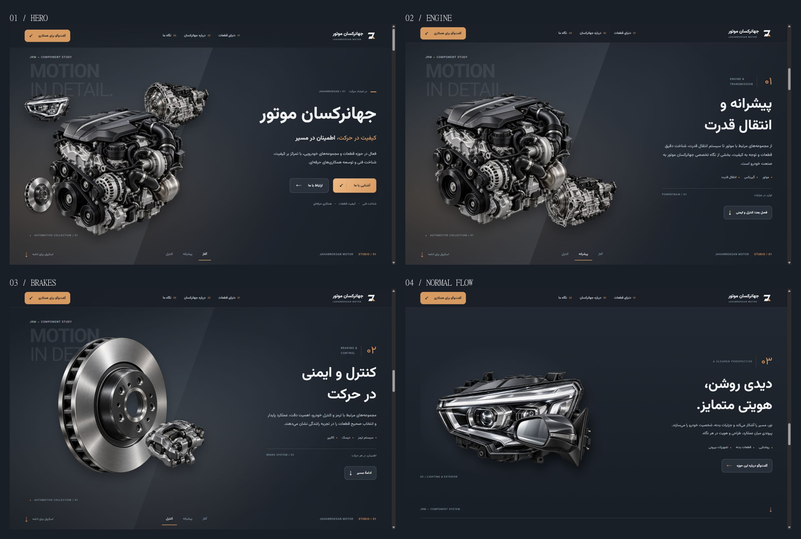

# Phase 5.1 — Editorial automotive UI and hero art direction

Implemented in the existing Astro/TypeScript project. No new automotive images, dependencies, narrative categories or footer redesign were introduced. All original anchors and the shared cinematic stage remain in place.

## Baseline and design system

Phase 4's screenshots, components and timeline were inspected before implementation. Its principal weaknesses were the largely uniform background, isolated product silhouettes, small chapter hierarchy, interchangeable pill labels and a header that did not establish much brand character.

The revised system combines an automotive component study with a Persian editorial layout: stronger typography, a directional graphite studio plane, restrained warm/cool lighting, numbered chapter identifiers and small category metadata. Text remains ordinary semantic content rather than a collection of cards. The company section receives only modest heading/eyebrow refinement; the footer is unchanged.

Colors remain centralized in `tokens.css`. The existing graphite/copper tokens are augmented with metallic illumination, warm/cool atmosphere and editorial-rule tokens. There are no external font requests, generated textures, WebGL or perpetual decorative animations.

## Header and hero

- Header: refined existing provisional mark at 38px, restrained translucent graphite, cleaner navigation spacing with decorative 01–03 indices, and a copper contact action. Its height compacts from 88px to 70px on desktop. Mobile uses 76px → 66px at narrow widths, a 44px menu control and 58px navigation rows. Existing menu, Escape and link-closing behavior is preserved.
- Hero: the engine is the dominant 70%-width object within the visual canvas. The gearbox sits above/right at 32%; the 23% headlight and small 20% disc provide directional counterpoints. The caliper is reserved for the brake scene; mirror and suspension remain available in later existing sections. All seven original images remain in the stage DOM and asset pipeline.
- Background: a soft metallic illumination and warm edge impression are supported by one oblique graphite plane. The brake scene adds a cooler lighting layer. The plane is removed in static layouts so its desktop geometry cannot turn into an arbitrary vertical stripe on long mobile content.
- Hierarchy: the main company title is heavier and slightly larger, with one uninterrupted text string. A copper emphasis in the supporting statement, restrained Latin exhibition typography, a component-study caption, and a compact technical endnote establish the visual identity.
- CTA: copper treatment, a separated arrow area, 11px corners and equal 54px desktop heights. Both mobile CTAs measure 48px high; at 320px they become full-width stacked actions. Existing destinations remain `#powertrain` and `#contact`.

## Typography, editorial details and narrative scenes

Self-hosted Vazirmatn remains the global Persian font. Rendered checks found it loaded, RTL active and zero font-family exceptions among headings, paragraphs, links, buttons, controls and footer text. Persian tracking remains zero. Hero sizes were measured at 64.8px, 57.6px and 44.54px for the three tested desktop widths, without forcing a title break.

Chapter numbers use a larger, lighter Persian treatment beside a small English category name. The numbers are separated by a short, purposeful rule. Chapter metadata identifies the subject below the copy; copper markers replace boxed tag chips. Active chapter navigation uses a restrained copper underline. Existing scroll-discovery and native chapter controls remain available.

Engine/gearbox imagery settles into a tighter, stronger arrangement. Brake composition now uses a 78% disc with a 32% caliper at its outer/lower-right region. The two scenes share typography and spacing while warm powertrain and cool brake illumination differentiate their atmosphere.

The existing normal-flow lighting/suspension chapters adopt the same number, heading and category treatment. Duplicate tiny product captions were hidden after visual inspection revealed a collision with the scene-level caption; meaningful image alt text and the single scene caption remain. The company section stays calmer and editorial, with a stronger heading weight and matching copper eyebrow marker.

Focus outlines remain 2px with offset. Buttons and navigation use the existing 220ms interaction token; reduced-motion styles suppress transitions and hover transforms.

## Timeline coupling and integrity

Before editing, the relationship between CSS image dimensions and percentage-based GSAP child poses was identified. Changing the image boxes without recalculating those poses would shift both the hero and reading compositions.

The revised CSS dimensions and the corresponding explicit child poses were updated together. Initial disc scale is `20 / 78`; its translation is normalized against the same fixed 1.12-aspect canvas. The caliper starts hidden and joins the disc only while the brake group is hidden at `engineExit`. Reverse scrolling restores its hidden hero state.

The normalized labels and durations, sticky 600svh section, 500svh travel, native anchor positions and reading holds are unchanged. The only additional master tween fades in the brake lighting layer during the existing 44–60% exchange. It does not introduce another trigger. The new layer is included in inline-style cleanup.

One master still owns the automotive groups, child poses, text and handoff. Explicit pixel/percentage translations, context reversion, original-style restoration and access states tied to the rendered playhead are preserved. At 52%, forward and reverse group/child matrices, opacity values, text/access states and lighting opacity matched exactly. After returning from mobile, the brake group returned to an identity matrix and opacity 1.

## Responsive and interaction validation

| Viewport | Title | Observed result |
| --- | --- | --- |
| 1440×900 | 64.8px, one line | Strong clustered hero, clear image/copy regions, refined full header |
| 1280×720 | 57.6px, one line | Hero and brake chapter fit the short viewport with readable actions |
| 1024×768 | 44.54px, one line | Engine and hero retain their hierarchy and safe header spacing |
| 768×1024 | 53.76px, one line | Deliberate vertical layout and simplified image pair |
| 390×844 | 42.9px, one line | Clear mobile hierarchy, equal 48px CTAs and full menu |
| 320×700 | 42px, two intentional lines | No heading clipping, stacked 265×48px CTAs, readable static chapters |

No horizontal overflow was observed at these sizes. Desktop → tablet → mobile → desktop transitions exercised matchMedia cleanup and refresh. All four fallback panels remained visible with opacity 1, no inline styles and no inert residue.

The primary CTA reached the powertrain reading hold. Desktop company navigation, mobile menu opening, Escape closing with focus return, contact selection and automatic menu closing were exercised. The contact anchor settled about 100px below the viewport top. Both a desktop navigation control and mobile menu showed the retained 2px keyboard outline.

Slow chapter inspection, large scroll jumps and reverse scrolling were tested. The ending handoff stayed fully visible at 100%, then released into the existing normal-flow lighting chapter. No sudden black end frame was observed. All seven stage images reported loaded.

## Build and asset verification

- Final `npm run typecheck`: passed.
- Final `npm run build`: passed, one static page.
- All seven original PNG SHA-256 hashes match the existing manifest.
- All 21 lossless WebP derivatives remain present.
- Production HTML references 31 image/font/bundle paths; all exist.
- 20 production IDs, no duplicates.
- Browser console: no warnings or errors observed.

Reproduce asset validation and screenshot sheets after building with `node scripts/verify-phase-5-1.mjs`. [Asset results](screenshots/phase-5-1/asset-validation.json), [browser console](screenshots/phase-5-1/browser-console.json), [viewport observations](screenshots/phase-5-1/evidence.json), [reverse comparison](screenshots/phase-5-1/reverse-validation.json).

## Screenshots and comparison

Full-size desktop captures: [hero](screenshots/phase-5-1/hero-1440.png), [engine](screenshots/phase-5-1/engine-1440.png), [brakes](screenshots/phase-5-1/brakes-1440.png), [first normal-flow section](screenshots/phase-5-1/normal-flow-1440.png), [company](screenshots/phase-5-1/company-1440.png), [52% exchange](screenshots/phase-5-1/exchange-52.png), [100% handoff](screenshots/phase-5-1/handoff-1440.png).

Responsive captures: [1280 hero](screenshots/phase-5-1/hero-1280.png), [1280 brakes](screenshots/phase-5-1/brakes-1280.png), [1024 hero](screenshots/phase-5-1/hero-1024.png), [1024 engine](screenshots/phase-5-1/engine-1024.png), [768 tablet](screenshots/phase-5-1/hero-768.png), [390 mobile](screenshots/phase-5-1/hero-390.png), [mobile menu](screenshots/phase-5-1/menu-390.png), [320 mobile](screenshots/phase-5-1/hero-320.png), [320 brake chapter](screenshots/phase-5-1/brakes-320.png).

[Side-by-side Phase 4 / Phase 5.1 comparison](screenshots/phase-5-1/comparison.png) shows the hero, engine and brakes. Phase 4 evidence remains unchanged. The comparison reveals stronger title/chapter hierarchy, the studio plane and differentiated lighting, tighter automotive relationships, refined navigation and less boxed supporting UI.

## Updated files

| File | Change |
| --- | --- |
| `src/components/Header.astro` | Numbered navigation and menu icon presentation |
| `src/styles/header.css` | Scoped header, compact and mobile styles |
| `src/components/Hero.astro` | Studio layers, editorial labels and scene metadata |
| `src/styles/cinematic-hero.css` | Art direction, typography, composition and responsive actions |
| `src/styles/tokens.css` | Shared atmosphere/editorial tokens |
| `src/scripts/cinematic-hero.ts` | Coupled image pose corrections and master lighting tween |
| `src/components/Narrative.astro` | Imports existing-chapter editorial styling |
| `src/styles/editorial.css` | Existing chapter presentation and modest company refinement |
| `scripts/verify-phase-5-1.mjs` | Asset checks and comparison sheets |
| `README.md`, this report, `docs/screenshots/phase-5-1/` | Documentation and visual evidence |

## Remaining limits

The available browser interface does not expose reduced-motion preference emulation. Its query gate and nonanimated branch were reviewed; the same fallback layout/cleanup branch was exercised at tablet/mobile widths. An actual OS preference toggle, hardware FPS profiling and a full cross-browser matrix were not performed.

The corporate copy remains editable draft text, the existing mark remains provisional and official contact information is still pending. No new visual blocker was observed in the tested layouts. Footer redesign, additional art and expanded storytelling remain outside this phase.
