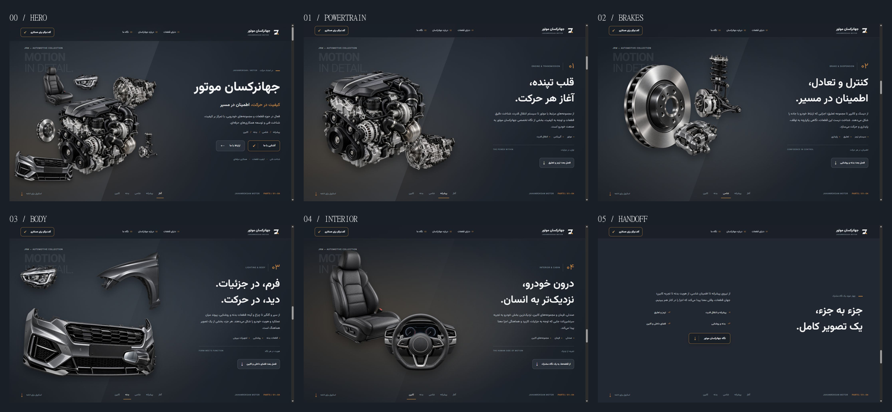

# Phase 5.2 — Full cinematic parts story

Implemented in the existing Astro/TypeScript/GSAP project. The shared sticky stage now covers the hero and all four parts chapters, followed by a concluding brand statement and the existing company section. No artwork was regenerated or flattened; no dependencies, Three.js or WebGL were added. Header navigation, company/contact content and footer structure remain intact.

## Hero art direction

The hero now shows seven independently positioned images: engine, gearbox, disc, bumper, seat, small headlight and small suspension assembly. Their hierarchy communicates powertrain, chassis, body/lighting and cabin coverage without making the objects equally prominent.

The engine remains the anchor at 58% of the image canvas width. Gearbox is 29%, seat 26%, bumper 39%, disc 18%, headlight 17% and suspension 18%. These are image-box dimensions; transparent silhouettes retain their original proportions. The seat sits behind the upper-left engine area, the gearbox above/right, and the bumper establishes the lower-left foreground. Smaller mechanical parts balance the cluster. Negative space separates it from the right-side title and actions.

The company name remains one semantic heading and one desktop line. The technical eyebrow, warm supporting statement and compact domain list reinforce the breadth of the business. The studio plane and soft metallic/warm lighting remain restrained. A redundant lower caption was removed after the broader foreground composition made it compete with the bumper.

## Brick-gold accent and CTA

The central accent is now `#C78B43`, supported by `#D39A52`, darker `#B87431` and warm hover/arrow `#E0AF6B`. Main graphite, off-white text and cool body-copy colors remain. The provisional mark and favicon adopt the same accent without changing the logo shape.

Primary **آشنایی با ما** now uses a deep graphite body, brick-gold border, off-white label and warm separated arrow area. Hover adds a controlled warm tint and border emphasis. The secondary contact action stays subdued graphite. Header contact adopts the bordered treatment. Primary destinations remain `#powertrain` and `#contact`.

Hero actions are 54px high on desktop and 48px on mobile, with 11px corners. At 320px they stack at 265×48px. Keyboard focus keeps the visible 2px outline and offset; motion preferences suppress UI transforms/transitions.

Measured token contrasts: off-white/deep 15.19, secondary/main graphite 8.77, accent/main graphite 5.09, accent/deep 5.69, warm arrow/deep 8.30, muted/elevated graphite 4.66. These token checks exceed 4.5; they are not a complete accessibility audit. [Contrast data](screenshots/phase-5-2/contrast.json).

## Four composed chapters

| Chapter | Independent assets | Composition |
| --- | --- | --- |
| 01 — Powertrain | Engine, gearbox | Large engine with lower/right gearbox; powerful, grounded silhouette |
| 02 — Brake & suspension | Disc, caliper, suspension | Dominant 65% disc, foreground 32% caliper and taller 45% suspension assembly at upper/right |
| 03 — Lighting & body | Bumper, fender, headlight, mirror | 88% bumper anchors the scene; 44% fender supplies upper structure; 25% headlight and 23% mirror are secondary |
| 04 — Interior & cabin | Seat, steering/dashboard assembly | Tall 62% seat balanced by a 48% foreground steering assembly, with calmer warm illumination |

Each chapter has a Persian heading, numbered editorial identifier, small technical label, restrained category markers, metadata and a native next-chapter action. The former oversized-headlight composition is replaced by a body-led arrangement. No second copy of the later narrative chapters remains in normal flow.

`src/data/cinematic-story.ts` is the single source for final image boxes, hero poses, depth order and chapter anchors. Astro renders CSS custom properties from it; GSAP calculates translations and scale from the same data and the 1.12 canvas ratio. This avoids hand-maintained pixel offsets and keeps resizing deterministic. Every automotive image remains an independent picture/DOM layer.

## One extended master timeline

The sticky section extends from 600svh to 1000svh, giving 900svh of native scroll travel. The stage stays 100svh. All automotive group, child, copy, atmosphere and handoff animation belongs to the same master. The obsolete normal-flow chapter timelines were removed; the header retains its independent compact-state trigger.

| Normalized progress | Behavior |
| --- | --- |
| 0–4% | Seven-part hero presentation holds |
| 4–12% | Hero text departs gradually; supporting groups begin clearing |
| 12–20% | Same engine and gearbox settle into the powertrain arrangement |
| 20–30% | Powertrain reading hold |
| 30–40% | Powertrain exits left/up; brake/suspension enters from right/lower while it remains visible |
| 40–50% | Brake/suspension reading hold |
| 50–60% | Tighter chassis departure and cleaner lateral body entrance with cool illumination |
| 60–70% | Lighting/body reading hold |
| 70–80% | Body departs laterally/up; cabin arrives with calmer displacement and scale |
| 80–90% | Cabin reading hold |
| 90–98% | Cabin departs and the background returns smoothly to the main graphite |
| 95–99% | Brand statement enters before the final cabin pixels leave |
| 99–100% and release | Statement stays readable as normal company content comes into view |

Each exchange uses coordinated eased group motion, overlapping incoming/outgoing visibility and a staged text switch. At 35%, 55% and 75%, both participating groups have opacity 0.5. The next text enters after the previous text finishes its exit, preventing readable text collision. No snapping, hijacking or perpetual autoplay was introduced.

Explicit pixel/percentage transform states, rendered-playhead access control, original-style snapshots and GSAP context teardown remain. Child poses reset only while their incoming group is hidden. Adjacent legacy anchor markers are restored in reverse order during cleanup so their original next siblings exist before insertion.

## Concluding statement and anchors

**جزء به جزء، یک تصویر کامل.** now follows all four categories. Its eyebrow reads **چهار حوزه، یک نگاه مشترک** and its supporting copy explicitly connects powertrain, chassis, body and cabin. Four category links recap the story. The final action leads directly to `#about`; the phrase no longer interrupts the story between automotive scenes.

Chapter anchors target the reading holds at 24%, 44%, 64% and 84%. `#suspension` remains a legacy alias for the brake/suspension hold, and `#more-parts` now points to the lighting/body hold. `#brand-statement` identifies the conclusion. Existing header/footer destinations remain valid. All fragment and ARIA targets were checked in production HTML.

## Responsive and interaction validation

| Viewport | Hero title | Result |
| --- | --- | --- |
| 1440×900 | 64.8px, one line | Seven-part hero and all four designed reading scenes inspected |
| 1280×720 | 57.6px, one line | Rich hero and body chapter fit the shorter desktop |
| 1024×768 | 44.54px, one line | Hero and cabin retain clear copy/image separation |
| 768×1024 | 53.76px, one line | Vertical static story; hero simplified to engine, bumper and seat |
| 390×844 | 42.9px, one line | Readable mobile flow, 48px actions; body and cabin compositions inspected |
| 320×700 | 42px, two intentional lines | Stacked full-width actions, readable conclusion and no horizontal overflow |

All six panels return to opacity 1 without inline style, inert or ARIA-hidden residue when the desktop enhancement is removed. All seven anchor markers return to the content layer. Mobile/tablet retain all four categories with independent, proportionate image layers. The desktop plane is disabled in the static layout.

A pointer issue was found and fixed during mobile QA: the transparent lower box of the bumper extended beyond the visible artwork and intercepted the next-chapter button. Static visual boxes are now clipped to their reserved canvas, and image layers do not receive pointer events. Browser hit-testing changed from the transparent PNG to the actual anchor; mouse and keyboard chapter actions were then exercised successfully.

Primary CTA, chapter actions, desktop cabin navigation, mobile menu expansion/Escape, focus outline, final brand action and legacy body navigation were checked. Font inspection found Vazirmatn loaded with no family exceptions. Slow inspection, fast jumps and reverse playback were exercised. At all three midpoint exchanges, group/child matrices, opacity and lighting values matched exactly in forward and reverse renders. [Exact comparison](screenshots/phase-5-2/reverse-validation.json).

After mobile → desktop restoration, the active body group returned to its identity matrix and opacity 1. All eleven stage images reported loaded. At 94% the cabin remains visible; at 97% the statement has opacity 0.75. An additional 324px beyond the pinned ending moved the stage to −324px and the company section to 576px in the 900px viewport. The ending background stays `rgb(34, 40, 49)` rather than switching to black.

## Build and asset checks

- Final `npm run typecheck`: passed.
- Final `npm run build`: passed; one static page.
- All eleven supplied PNGs are 1254×1254 with alpha and match their recorded SHA-256 hashes.
- Twelve new lossless WebP derivatives were added at 384/768/native widths; total 33. The original 21 derivatives were preserved.
- `PartSlot.astro` now derives dimensions and srcset widths from the manifest rather than hardcoding 1254.
- All 47 production image/font/bundle paths exist.
- 22 IDs, no duplicates; no broken fragment links or ARIA targets.
- Four automotive groups and six text panels in production HTML.
- Final browser console inspection returned no warnings or errors.

Reproduce asset, link, contrast and screenshot-sheet checks after building with `node scripts/verify-phase-5-2.mjs`. [Asset/link results](screenshots/phase-5-2/asset-validation.json), [browser console](screenshots/phase-5-2/browser-console.json), [viewport/checkpoint observations](screenshots/phase-5-2/evidence.json).

## Visual evidence

Full-resolution required captures: [hero](screenshots/phase-5-2/hero-1440.png), [powertrain](screenshots/phase-5-2/powertrain-1440.png), [brake/suspension](screenshots/phase-5-2/brakes-1440.png), [lighting/body](screenshots/phase-5-2/body-1440.png), [interior/cabin](screenshots/phase-5-2/interior-1440.png), [brand statement](screenshots/phase-5-2/handoff-1440.png).

Transitions: [35%](screenshots/phase-5-2/exchange-35.png), [55%](screenshots/phase-5-2/exchange-55.png), [75%](screenshots/phase-5-2/exchange-75.png), [94%](screenshots/phase-5-2/release-94.png), [97%](screenshots/phase-5-2/release-97.png), [normal-flow release](screenshots/phase-5-2/flow-release.png).

Responsive: [1280 hero](screenshots/phase-5-2/hero-1280.png), [1280 body](screenshots/phase-5-2/body-1280.png), [1024 hero](screenshots/phase-5-2/hero-1024.png), [1024 cabin](screenshots/phase-5-2/interior-1024.png), [768 tablet](screenshots/phase-5-2/hero-768.png), [390 hero](screenshots/phase-5-2/hero-390.png), [390 body](screenshots/phase-5-2/body-390.png), [390 cabin](screenshots/phase-5-2/interior-390.png), [320 hero](screenshots/phase-5-2/hero-320.png), [320 conclusion](screenshots/phase-5-2/handoff-320.png).

[Phase 5.1 / Phase 5.2 comparison](screenshots/phase-5-2/comparison.png) contrasts the broader hero and the replacement of the oversized headlight scene with a body-led composition. Earlier evidence remains unchanged.

## Updated files

- `src/data/landing.ts`: eleven assets and four category definitions.
- `src/data/cinematic-story.ts`: shared poses, composition groups and chapter anchor data.
- `src/components/Hero.astro`: broader hero, four image groups, atmospheres, concluding statement and chapter navigation.
- `src/components/Narrative.astro`: four semantic panels/static image layouts inside the shared stage.
- `src/components/PartSlot.astro`: manifest-driven dimensions and responsive sources.
- `src/pages/index.astro`: removes duplicate normal-flow narrative rendering.
- `src/scripts/cinematic-hero.ts`: one expanded timeline, coordinated exchanges, accessible cleanup.
- `src/scripts/landing.ts`: retains navigation/header lifecycle and removes the obsolete separate chapter timelines.
- `src/styles/cinematic-hero.css`: composition boxes, longer sticky stage, dark bordered actions, static image hit-box fix.
- `src/styles/tokens.css`, `src/styles/header.css`, `public/favicon.svg`: controlled brick-gold identity and header action.
- `src/styles/editorial.css`: retains calmer company treatment; retires unused former normal-flow chapter overrides.
- `scripts/prepare-parts.mjs`, `public/images/parts/optimized/manifest.json` and twelve new WebPs: incremental lossless asset preparation.
- `scripts/verify-phase-5-2.mjs`, README, this report and `docs/screenshots/phase-5-2/`: validation and visual evidence.

## Remaining limits

No unresolved functional or layout blocker was observed in the tested views. The browser interface does not expose reduced-motion preference emulation: its unchanged query gate was reviewed, and the same static layout/cleanup branch was exercised through tablet/mobile changes. An actual OS preference toggle, hardware FPS profiling and a full cross-browser matrix were not performed.

Corporate copy remains editable draft content, the mark remains provisional and official contact information is still pending. The footer was not redesigned in this phase.
